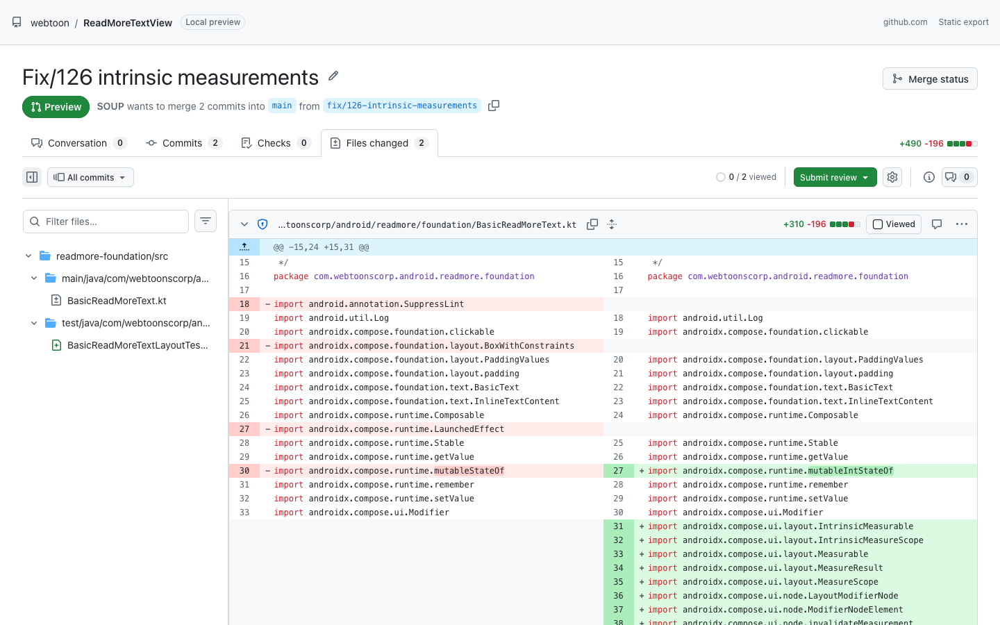
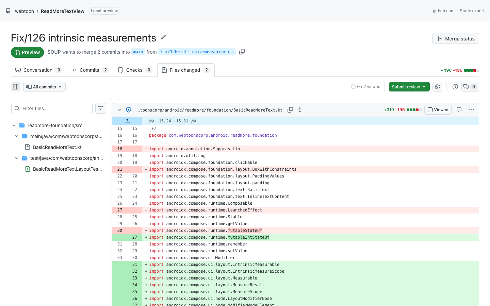
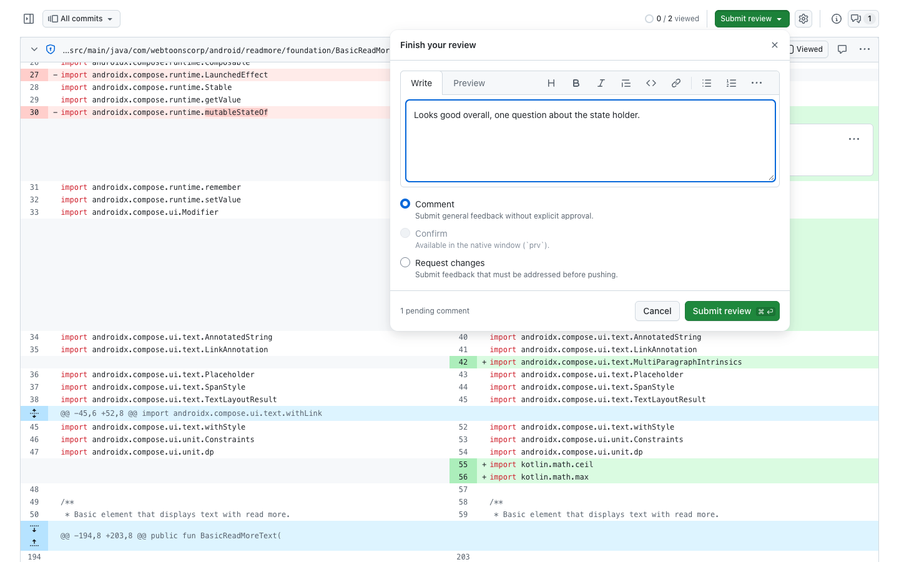
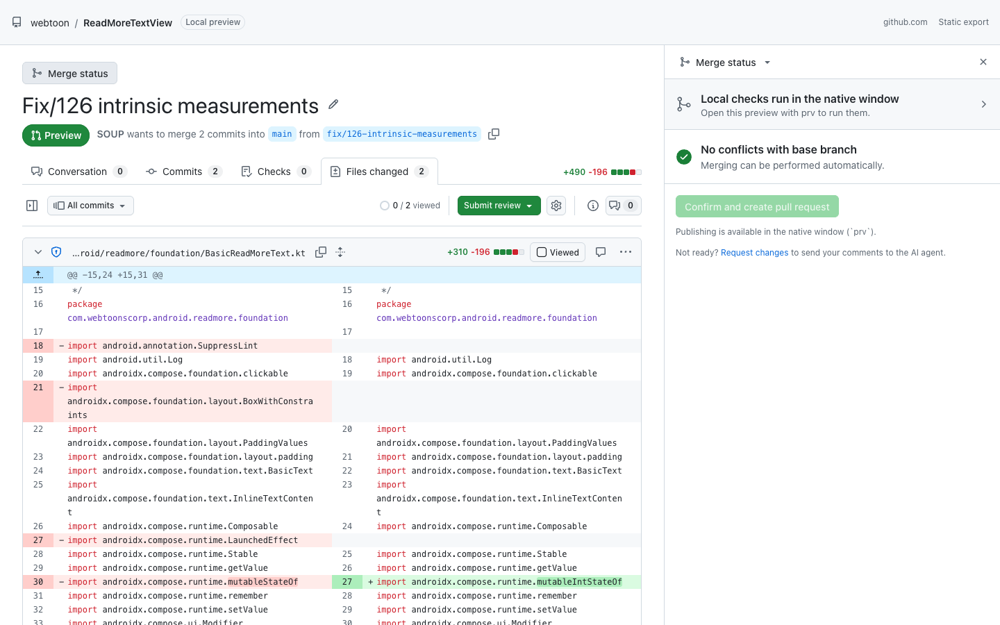
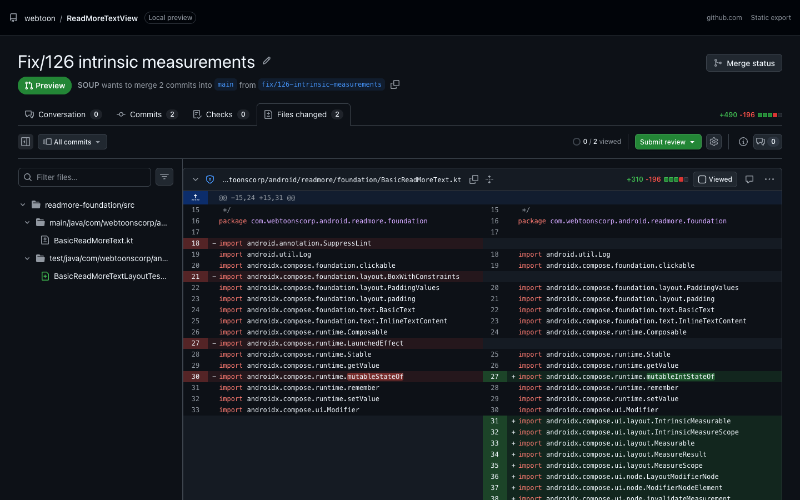

# prv — local pull request preview

Preview your branch **exactly the way github.com's pull request "Files changed" page shows it**,
before you push. Review it with line comments, hand the review to an AI agent (Claude Code), run
local checks, and when you are happy press **Confirm** to push the branch and open the pull request.

- **Same look and options as github.com** (the new *Files changed* experience, 2026), built on the
  same Primer React release github.com runs: sticky toolbar, *All commits* picker (*Changes since
  your last review*, commit ranges), resizable file tree with filters, *Viewed* files, settings
  (*Unified / Split*, *Whitespace changes*, *Minimize comments*, *Compact line height*), expandable
  context, word-level highlights, GitHub's syntax highlighting (`pl-*`), CODEOWNERS, *Overview /
  Comments / Merge status* panels and every Primer theme (light, dark, dimmed, high contrast).
- **Any window size and zoom**: from a phone-sized 320px window to 4K, the page changes layout at
  the same widths github.com does (file tree and side panels become dialogs, labels shorten,
  toolbar controls move into an overflow menu, …). The native window zooms with Cmd/Ctrl + `=` /
  `-` / `0` like a browser.
- **Kept in sync with github.com**: measuring tools capture the signed-in page and compare it with
  prv pixel by pixel ([docs/design-sync.md](docs/design-sync.md)).
- **Same comparison as a pull request**: three-dot diff from the merge base of `origin/<base>`
  (fetched first), rename detection, `.gitattributes` `linguist-generated`, lock files
  collapsed, binary / submodule / mode changes, CRLF, *No newline at end of file*.
- **No web server**: a native window (system WebView via Tauri) talks to the CLI over IPC.
  Nothing listens on a port.
- **Talks to `origin` only**: prv fetches the base branch from `origin` (skip with `--no-fetch`),
  looks up an open pull request on origin's GitHub host when the merge panel opens, and pushes and
  opens the pull request when you press *Confirm*. Nothing else leaves the machine: no other
  remote, no submodule hosts, no GitHub CLI telemetry or update checks, and images in pull request
  descriptions or commit messages are not loaded (they show as links, unlike github.com, which
  serves them through its image proxy). Local checks run your own commands, which may use the
  network like they would in a terminal.
- **Made for AI-assisted coding**: `prv` blocks until you submit a review and prints it to stdout
  (Markdown or JSON) with file, line, code snippet and comment — Claude Code acts on it directly.

| Split | Unified |
|---|---|
|  |  |

| Review | Merge status |
|---|---|
|  |  |



## Why

On a busy GitHub (Enterprise) instance, pull request checks can take hours and every
"push → look at the diff on GitHub → fix → push again" round adds load and waiting. `prv` lets you
do those rounds locally, in the same UI, and only push once the change is right.

## Install

Requirements: `git`. To build from source: Rust (`rustup`) and Node.js 20+.
To open pull requests: the [GitHub CLI](https://cli.github.com) (`gh auth login`, works with
GitHub Enterprise Server hosts too).

```bash
git clone https://github.com/fornewid/github-preview-local.git
cd github-preview-local
./scripts/install.sh            # builds and installs ~/.local/bin/prv
```

Linux needs the WebKitGTK runtime (`libwebkit2gtk-4.1`); Windows uses WebView2 (preinstalled on
Windows 10/11).

### Claude Code plugin

```text
/plugin marketplace add fornewid/github-preview-local
/plugin install prv@github-preview-local
```

Then run `/prv` (or just ask Claude to "preview the PR"). The window opens; when you submit,
Claude receives your review and addresses each comment. *Confirm* pushes and opens the PR.

## Usage

```bash
prv                         # HEAD vs the remote default branch (fetches the base first)
prv --base develop          # another base branch (origin/develop if it exists)
prv --uncommitted           # include uncommitted + untracked changes (staging area untouched)
prv --no-fetch              # do not fetch the base branch
prv --format json           # JSON review on stdout
prv -C path/to/repo         # run in another repository

prv export [--open] [-o f]  # self-contained HTML (UI + data), opens from disk — for SSH/remote
prv checks [--json] [name]  # run local checks headless (exit 1 on failure)
prv list-checks             # show configured / auto-detected checks
```

Settings from the gear menu (*Unified / Split*, *Whitespace changes*, *Minimize comments* — `i`,
*Compact line height*) are remembered, like on GitHub. `t` focuses the file filter. The side
panel can be resized by dragging its edge. Cmd/Ctrl + `=` / `-` / `0` zoom the native window (the
level is remembered); in a browser (`prv export`) use the browser's zoom.

### Reviewing

- Hover a line and click **+** to comment; click line numbers (shift-click for a range) to comment
  on several lines; the comment button in a file header comments on the whole file. The comment box
  has GitHub's formatting toolbar, including *suggestions*.
- **Submit review** → *Comment*, *Request changes* or **Confirm** (replaces *Approve*).
  - *Comment / Request changes*: the window closes and the review is printed to stdout.
  - *Confirm*: edit the PR title / description (prefilled from the commit or
    `.github/pull_request_template.md`), optionally *draft*, then `prv` pushes the reviewed commit
    and runs `gh pr create` (or reuses the open PR). Also available from **Merge status**, which
    shows the local checks and whether the branch conflicts with the base branch.
- *All commits* → *Changes since your last review* shows only the commits added since you last
  submitted a review.
- Pending comments, *Viewed* state and the last review are saved in `.git/prv/` (never committed).

Example output:

````markdown
# Pull request preview: Changes requested

`fix/126-intrinsic-measurements` (872122b) → `main` (merge-base 61dfeb4) · 2 files · 1 comment

The reviewer requested changes. Address every comment below, then run `prv` again to request another review.

## Comments

### 1. `readmore-foundation/.../BasicReadMoreText.kt` line 27 (new side)
```diff
+import androidx.compose.runtime.mutableIntStateOf
```

Use `mutableIntStateOf` only if the value is always an Int.
````

### Local checks

Define checks in `.prv.toml` at the repository root:

```toml
[[checks]]
name = "lint"
run = "./gradlew ktlintCheck"

[[checks]]
name = "test"
run = "npm test"
timeout = 600   # seconds
```

Without a config, prv detects `package.json` scripts (lint, typecheck, check, test),
`./gradlew check`, Cargo, Go, Makefile `lint`/`test` targets and pre-commit. Commands run in the
repository root with `PRV_BASE`, `PRV_BASE_SHA`, `PRV_HEAD`, `PRV_MERGE_BASE` and
`PRV_CHANGED_FILES` (newline-separated) in the environment. Results appear in the **Checks** tab
and in the *Merge status* panel.

## How it works

```
prv (Rust CLI)                          native window (system WebView)
 ├─ git: merge-base, diff --raw/--numstat/-U3 (and -w), cat-file   ◄── Tauri IPC ──►  React UI
 ├─ merge-tree conflicts, CODEOWNERS of the base branch                      ├─ Primer React (github.com's release) + primitives
 ├─ checks runner (.prv.toml / auto-detect)                                  ├─ starry-night (GitHub grammars, pl-* classes)
 ├─ publish: git push + gh pr create                                         └─ GitHub's new Files changed layout (prv.css)
 └─ prints the review to stdout on exit
```

The UI is a single HTML file (highlighter worker and WASM inlined) embedded in the binary;
`prv export` writes the same file with the data embedded.

- `ui/` — React + TypeScript UI (`npm run dev` serves `public/dev-data.json` from `prv export --data`)
- `src-tauri/` — Rust CLI / native window (`cargo build --release`)
- `plugin/` — Claude Code plugin (`/prv` command and skill)
- `tools/reference/` — measure the signed-in github.com page with your local Chrome, compare prv
  with it and run UI tests; see [docs/design-sync.md](docs/design-sync.md)

## Development

```bash
npm --prefix ui install && npm --prefix ui run build
cargo build --release --manifest-path src-tauri/Cargo.toml
PRV_SELFTEST=1 src-tauri/target/release/prv --no-fetch   # opens the window, reports what rendered (and that code
                                                         # draws in Chrome's font, not WebKit's SF Mono), exits

# The native-only features, clicked through in the real window: a commit range, local checks
# (pass, fail, cancel) and Confirm (push + pull request, then pushing to that open pull request).
scripts/native-selftest.sh                               # offline: local remote, stand-in `gh`
scripts/native-selftest.sh --github you/scratch-repo     # real push and pull request (your login)

cd tools/reference && npm install
node ui-test.mjs path/to/export.html                     # end-to-end checks of the review UI
```

The page is compared with the signed-in github.com page using the tools in `tools/reference`;
see [docs/design-sync.md](docs/design-sync.md) and the measured values in
[docs/reference.md](docs/reference.md).

## License

MIT. Uses Primer React, Primer primitives and Octicons (MIT) and starry-night (MIT; grammars under
their own licenses). Not affiliated with GitHub.
