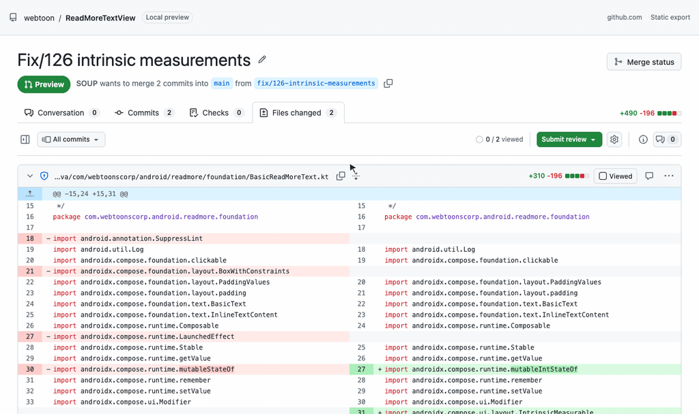
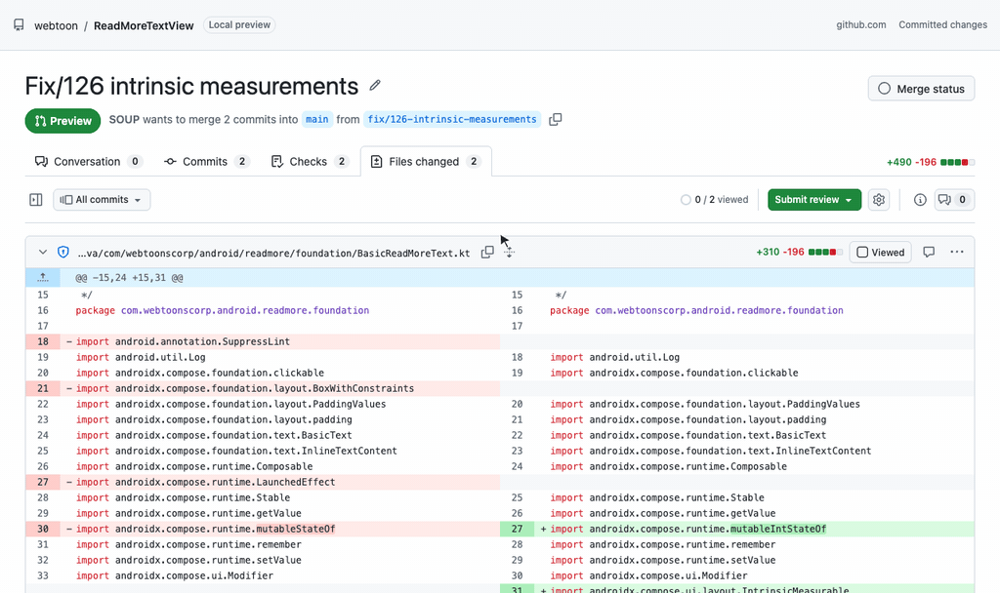
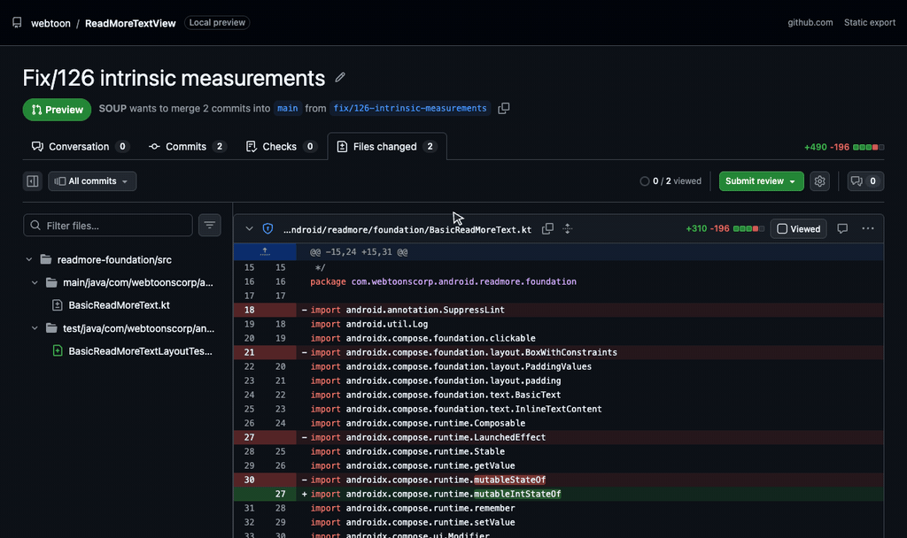
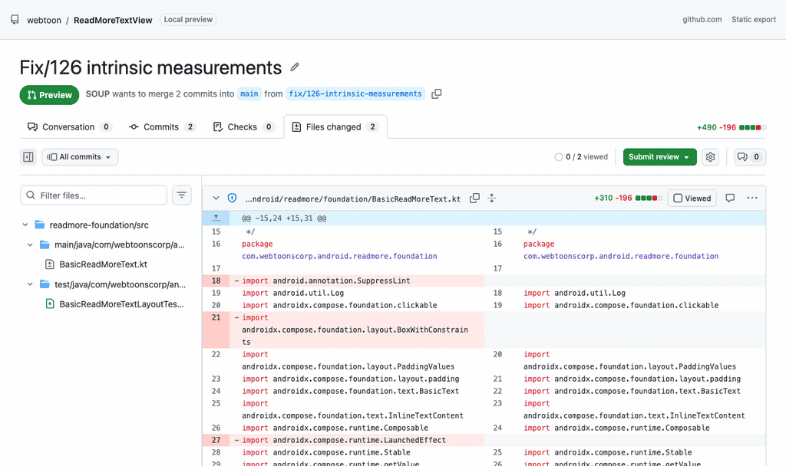

# gh-prv-local — local pull request preview

Preview your branch **exactly the way github.com's pull request "Files changed" page shows it**,
before you push. Review it with line comments, hand the review to an AI agent (Claude Code), run
local checks, and when you are happy press **Confirm** to push the branch and open the pull request.

- **Same look and options as github.com** (the new *Files changed* experience, 2026), built on the
  same Primer React release github.com runs: sticky toolbar, *All commits* picker (*Changes since
  your last review*, commit ranges), resizable file tree with filters, *Viewed* files, settings
  (*Unified / Split*, *Whitespace changes*, *Minimize comments*, *Compact line height*), expandable
  context, word-level highlights, GitHub's syntax highlighting (`pl-*`), CODEOWNERS, image files
  (*2-up / Swipe / Onion Skin*), commits that open their own changes, the *Comments* panel, and
  light or dark following the system (an export also takes `?theme=dark_dimmed`,
  `light_high_contrast`, …). Cmd/Ctrl + F finds text in all the changes, also in files not
  rendered yet.
- **Only what a local review needs**: no pull request description or *Merge status* panel; the
  title and the tabs stay in place on every tab.
- **Any window size and zoom**: from a phone-sized 320px window to 4K, the page changes layout at
  the same widths github.com does (file tree and side panels become dialogs, labels shorten,
  toolbar controls move into an overflow menu, …). The native window (`--window`) zooms with Cmd/Ctrl + `=` /
  `-` / `0` like a browser.
- **Kept in sync with github.com**: measuring tools capture the signed-in page and compare it with
  gh-prv-local pixel by pixel ([docs/design-sync.md](docs/design-sync.md)).
- **Same comparison as a pull request**: three-dot diff from the merge base of `origin/<base>`
  (fetched first), rename detection, `.gitattributes` `linguist-generated`, lock files
  collapsed, binary / submodule / mode changes, CRLF, *No newline at end of file*.
- **A browser tab, or a native window**: the page opens in a browser tab (like plannotator),
  served on 127.0.0.1 for that run only: every call needs the run's token (traded once for the
  one-time code in the address it opens) and must come from that page, and closing the tab ends
  the run (so does a page never opened within 10 minutes). With `--window` it opens in a native window
  instead (system WebView via Tauri), which talks to the CLI over IPC: nothing listens on a port.
- **Talks to `origin` only**: gh-prv-local fetches the base branch from `origin` (skip with `--no-fetch`),
  looks up an open pull request on origin's GitHub host when you choose *Confirm*, and pushes and
  opens the pull request when you press *Confirm*. Nothing else leaves the machine: no other
  remote, no submodule hosts, no GitHub CLI telemetry or update checks, and images in pull request
  descriptions or commit messages are not loaded (they show as links, unlike github.com, which
  serves them through its image proxy). Local checks run your own commands, which may use the
  network like they would in a terminal.
- **Made for AI-assisted coding**: `gh-prv-local` blocks until you submit a review and prints it to stdout
  (Markdown or JSON) with file, line, code snippet and comment — Claude Code acts on it directly.

**Review with line comments; the review goes back to Claude Code.**



**Local checks, then *Confirm* to push and open the pull request.**



**Split or unified, every theme, the file tree, and find in the changes.**



**Any window size, laid out the way github.com does.**



## Why

On a busy GitHub (Enterprise) instance, pull request checks can take hours and every
"push → look at the diff on GitHub → fix → push again" round adds load and waiting. `gh-prv-local` lets you
do those rounds locally, in the same UI, and only push once the change is right.

## Install

macOS and Linux:

```bash
curl -fsSL https://raw.githubusercontent.com/fornewid/github-preview-local/main/scripts/install.sh | bash
# or with the GitHub CLI signed in (also while the repository is private):
gh api repos/fornewid/github-preview-local/contents/scripts/install.sh -H 'Accept: application/vnd.github.raw' | bash
```

This installs the latest [release](https://github.com/fornewid/github-preview-local/releases)'s
binary to `~/.local/bin/gh-prv-local` after checking its SHA-256. Run it again to update, or pin a
version with `| bash -s -- v0.1.0`; gh-prv-local itself never checks for updates. On Windows,
download `gh-prv-local-windows-x64.exe` from the release and save it as `gh-prv-local.exe` in a
folder on your `PATH`.

Requirements: `git`. To open pull requests: the [GitHub CLI](https://cli.github.com)
(`gh auth login`, works with GitHub Enterprise Server hosts too). Linux needs the WebKitGTK runtime
(`libwebkit2gtk-4.1`); Windows uses WebView2 (preinstalled on Windows 10/11).

From source (Rust and Node.js 20+): `./scripts/install.sh --source` in a clone.

### Claude Code plugin

```text
/plugin marketplace add fornewid/github-preview-local
/plugin install gh-prv-local@github-preview-local
```

Then run `/gh-prv-local` (or just ask Claude to "preview the PR"). A browser tab opens; when you submit,
Claude receives your review and addresses each comment. *Confirm* pushes and opens the PR.

## Usage

```bash
gh-prv-local                         # HEAD vs the remote default branch (fetches the base first), in a browser tab
gh-prv-local --base develop          # another base branch (origin/develop if it exists)
gh-prv-local --uncommitted           # include uncommitted + untracked changes (staging area untouched)
gh-prv-local --no-fetch              # do not fetch the base branch
gh-prv-local --browser=chrome        # in a given browser (or GH_PRV_LOCAL_BROWSER=chrome); none: only print the address
gh-prv-local --window                # in a native window instead (no server)
gh-prv-local --format json           # JSON review on stdout
gh-prv-local -C path/to/repo         # run in another repository

gh-prv-local export [--open] [-o f]  # self-contained HTML (UI + data), opens from disk — for SSH/remote
gh-prv-local checks [--json] [name]  # run local checks headless (exit 1 on failure)
gh-prv-local list-checks             # show configured / auto-detected checks
```

Settings from the gear menu (*Unified / Split*, *Whitespace changes*, *Minimize comments* — `i`,
*Compact line height*) are remembered, like on GitHub. `t` focuses the file filter. The side
panel can be resized by dragging its edge. Cmd/Ctrl + `=` / `-` / `0` zoom the native window (the
level is remembered); in a browser tab (and an export) use the browser's zoom.

### Reviewing

- Hover a line and click **+** to comment; click line numbers (shift-click for a range) to comment
  on several lines; the comment button in a file header comments on the whole file. The comment box
  has GitHub's formatting toolbar, including *suggestions*.
- **Submit review** → *Comment*, *Request changes* or **Confirm** (replaces *Approve*).
  - *Comment / Request changes*: the review is printed to stdout and gh-prv-local ends (the window
    closes; a tab says it is done).
  - *Confirm*: edit the PR title / description (prefilled from the commit or
    `.github/pull_request_template.md`), optionally *draft*, then `gh-prv-local` pushes the reviewed commit
    and runs `gh pr create` (or reuses the open PR). Also available from the **Conversation** tab,
    which shows the local checks and whether the branch conflicts with the base branch.
- *All commits* → *Changes since your last review* shows only the commits added since you last
  submitted a review. A commit's title (in *Commits* or *Conversation*) shows just that commit.
- Cmd/Ctrl + F opens a find bar: Enter / Shift+Enter (or Cmd/Ctrl + G) go through the matches,
  opening collapsed files on the way; Escape closes it.
- Pending comments, *Viewed* state and the last review are saved in `.git/gh-prv-local/` (never committed).

Example output:

````markdown
# Pull request preview: Changes requested

`fix/126-intrinsic-measurements` (872122b) → `main` (merge-base 61dfeb4) · 2 files · 1 comment

The reviewer requested changes. Address every comment below, then run `gh-prv-local` again to request another review.

## Comments

### 1. `readmore-foundation/.../BasicReadMoreText.kt` line 27 (new side)
```diff
+import androidx.compose.runtime.mutableIntStateOf
```

Use `mutableIntStateOf` only if the value is always an Int.
````

### Local checks

Define checks in `.gh-prv-local.toml` at the repository root:

```toml
[[checks]]
name = "lint"
run = "./gradlew ktlintCheck"

[[checks]]
name = "test"
run = "npm test"
timeout = 600  # seconds
```

Without a config, gh-prv-local detects `package.json` scripts (lint, typecheck, check, test),
`./gradlew check`, Cargo, Go, Makefile `lint`/`test` targets and pre-commit. Commands run in the
repository root with `GH_PRV_LOCAL_BASE`, `GH_PRV_LOCAL_BASE_SHA`, `GH_PRV_LOCAL_HEAD`,
`GH_PRV_LOCAL_MERGE_BASE` and `GH_PRV_LOCAL_CHANGED_FILES` (newline-separated) in the environment.
Results appear in the **Checks** tab and on the **Conversation** tab.

## How it works

```
gh-prv-local (Rust CLI)                                     browser tab (HTTP, 127.0.0.1) or native window (--window)
 ├─ git: merge-base, diff --raw/--numstat/-U3 (and -w), cat-file   ◄── HTTP / Tauri IPC ──►  React UI
 ├─ merge-tree conflicts, CODEOWNERS of the base branch                      ├─ Primer React (github.com's release) + primitives
 ├─ checks runner (.gh-prv-local.toml / auto-detect)                         ├─ starry-night (GitHub grammars, pl-* classes)
 ├─ publish: git push + gh pr create                                         └─ GitHub's new Files changed layout (prv.css)
 └─ prints the review to stdout on exit
```

For a browser tab, the CLI serves the page and the window's calls over HTTP on 127.0.0.1 (port
19514, or a free one; `GH_PRV_LOCAL_PORT` picks it, e.g. to forward it over SSH with
`--browser=none`). The address it opens carries a one-time code: the page trades it for the run's
token once (so the address is useless to anyone who sees it later), sends the token with every
call, and the server also checks the `Host`, `Origin` and `Sec-Fetch-Site` headers. On a Mac the
default browser gets the address through AppleScript, so no command line carries it; a named
browser or Linux's `xdg-open` show it on a command line for a moment, so on a machine that others
log in to, prefer `--browser=none` and open the address yourself.

The UI is a single HTML file (highlighter worker and WASM inlined) embedded in the binary;
`gh-prv-local export` writes the same file with the data embedded.

- `ui/` — React + TypeScript UI (`npm run dev` serves `public/dev-data.json` from `gh-prv-local export --data`)
- `src-tauri/` — Rust CLI / native window (`cargo build --release`)
- `plugin/` — Claude Code plugin (`/gh-prv-local` command and skill)
- `tools/reference/` — measure the signed-in github.com page with your local Chrome, compare gh-prv-local
  with it and run UI tests; see [docs/design-sync.md](docs/design-sync.md)

## Development

```bash
npm --prefix ui install && npm --prefix ui run build
cargo build --release --manifest-path src-tauri/Cargo.toml
# Opens the native window, reports what rendered (and that code draws in Chrome's font, not
# WebKit's SF Mono), exits.
GH_PRV_LOCAL_SELFTEST=1 src-tauri/target/release/gh-prv-local --no-fetch

# The native-only features, clicked through in the real window: a commit range, local checks
# (pass, fail, cancel) and Confirm (push + pull request, then pushing to that open pull request).
scripts/native-selftest.sh                            # offline: local remote, stand-in `gh`
scripts/native-selftest.sh --github you/scratch-repo  # real push and pull request (your login)

cd tools/reference && npm install
node ui-test.mjs path/to/export.html                  # end-to-end checks of the review UI
node browser-test.mjs path/to/gh-prv-local scratch-repo   # the browser tab mode, its guards, submit and close
node docgifs.mjs path/to/export.html                  # the README animations (needs ffmpeg)
```

The page is compared with the signed-in github.com page using the tools in `tools/reference`;
see [docs/design-sync.md](docs/design-sync.md) and the measured values in
[docs/reference.md](docs/reference.md).

### Releasing

`scripts/release.sh X.Y.Z` sets the version of the CLI and of the Claude Code plugin, commits and
tags `vX.Y.Z`. Pushing `main` and the tag runs [the release workflow](.github/workflows/release.yml):
tests, then binaries for macOS (arm64, x64), Linux (x64, arm64) and Windows (x64), each with a
`.sha256`, published as the GitHub release.

## License

MIT. Uses Primer React, Primer primitives and Octicons (MIT) and starry-night (MIT; grammars under
their own licenses). Not affiliated with GitHub.
